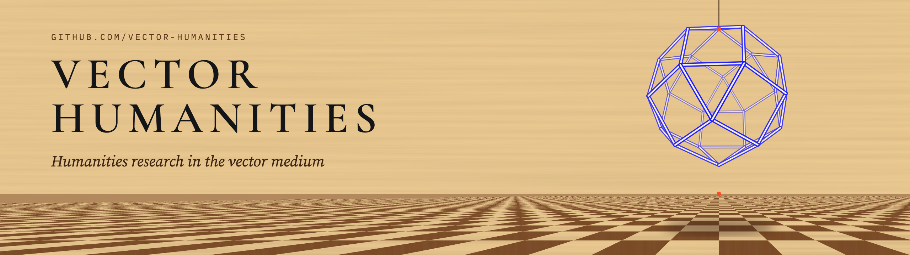

  

  <a href="https://vector-humanities.github.io"><b>Site</b></a> &nbsp;·&nbsp;
  <a href="#projects">Projects</a> &nbsp;·&nbsp;
  <a href="#methods">Methods</a> &nbsp;·&nbsp;
  <a href="https://vector-lab-tools.github.io">Vector Lab</a>

---

Large language models and diffusion systems hold text, image and sound as positions in high-dimensional vector spaces, and they generate new material by moving through those spaces. Humanities scholars now meet their archives, their sources and their own research tools inside this **vector medium**.

**Vector Humanities** is where humanities projects are carried out in that medium. Each repository has a humanities object at its centre (a book to translate, a corpus to read, an archive to edit) and works on it with methods and theory developed in the wider vector theory programme: the theory of the vector medium, the Vector Lab instruments, critical code studies, and vector translation. The methods are developed elsewhere; the projects here apply them to particular texts and collections.

Vector Humanities also takes a step forward that the vector medium makes possible, here called **vector toolmaking**: creating tools, digital or vector-based, that enable humanities scholars to research and work with their materials. The benches, instruments and toolkits under [Methods](#methods) are its first examples.

## Projects

| Project | Object | Method | Status |
|:--|:--|:--|:--|
| **偶然性の問題 · The Problem of Contingency** | Kuki Shūzō, *Gūzensei no mondai* (Iwanami, 1935), from the National Diet Library scans of the 1948 printing | Vector translation | Preliminary English translation complete (October 2026), readable and literal versions with apparatus; now being checked against the *Kuki Shūzō zenshū* and Omodaka's French translation (1966) |
| **[Melville Research Bench](https://vector-humanities.github.io/melville/)** (Michael Jonik and David M. Berry) | Herman Melville, *Billy Budd* in four versions (manuscript before revision, last readings, diplomatic, MEL reading text) and the short tales, from the Melville Electronic Library's TEI | Research bench on [bench-kit](https://github.com/critical-code-studies/bench-kit), the first of the benches whose texts are prose | Alpha |
| **[Spacewar! (1962)](https://spacewar1962.github.io/spacewar/)** (David M. Berry and Mark C. Marino, with Anthony Hay, Sarah Ciston, Art Schwarz, Claire Carroll and Norbert Landsteiner) | The DEC PDP-1 space-combat game written at MIT in 1961–62, its Macro assembly source and surviving versions | Critical code studies reading, with a runnable PDP-1 emulator and the Research Bench | Site and Research Bench live; monograph in progress |
| **[SHRDLU (1968–70)](https://critical-code-studies.github.io/SHRDLU/)** (David M. Berry and Mark C. Marino) | Terry Winograd's natural-language-understanding program, MacLisp and Micro-Planner, MIT AI Lab | Critical code studies reading, with the SHRDLU Research Bench on bench-kit | Site and Research Bench live |

More projects will be added as they begin.

## Methods

| Method | Developed in | Used here for |
|:--|:--|:--|
| **Vector theory** | Berry, D. M. (2026) '[Vector theory: epistemology, political economy, and probabilistic computation](https://doi.org/10.1007/s13347-026-01162-w)', *Philosophy & Technology*, 39, 149 | The account of the medium: difference becomes distance, meaning becomes location, and the geometry shapes what can be represented, retrieved and said |
| **Vector Lab** | [vector-lab-tools](https://github.com/vector-lab-tools): Manifold Atlas, LLMbench, Vectorscope, Manifoldscope, Theoryscope | Testing interpretive claims against the measured behaviour of embedding and language models |
| **Critical code studies** | [critical-code-studies](https://github.com/critical-code-studies) | Close reading of the code, prompts and briefs that do the work in a project |
| **Vector translation** | [vector-translation](https://vector-humanities.github.io/vector-translation/) (v0.1) | A method and toolkit for translating books from page images with AI agents under a translator's direction: procedure, rules, Claude Code skills, brief templates and checking scripts |
| **Vector Book** | [vector-book](https://github.com/vector-humanities/vector-book) (alpha) | Book design and typesetting for editions and translations: Markdown through Pandoc and Typst to a print-ready PDF, with source page numbers, translator's notes and glossed figures |

## Working conventions

- **Provenance.** Every project records its source edition, the scans it works from, and their rights status.
- **AI disclosure.** Machine drafting is identified as such. Decisions on terms, readings and corrections are logged in the project with their dates.
- **Instrument and material.** Where a model is used to read or measure, the project tries to separate what belongs to the instrument from what belongs to the material.
- **Open Access.** Public-domain sources and project outputs can be published through this work. Open access publications are a key output of this project wherever possible. This project is committed to open science practices.

## Related

- **[Vector Lab](https://vector-lab-tools.github.io)**: research instruments for reading the vector medium.
- **[Critical Code Studies](https://critical-code-studies.github.io)**: tools and benches for reading code as cultural text.

---

Vector Humanities is directed by <a href="https://github.com/dmberry">David M. Berry</a> (University of Sussex).

The mark is the rhombicuboctahedron Leonardo drew for Luca Pacioli's <i>De divina proportione</i> (1509), as a wireframe. The banner is an intarsia pavement in perspective, after the inlaid-wood panels of Fra Giovanni da Verona.
