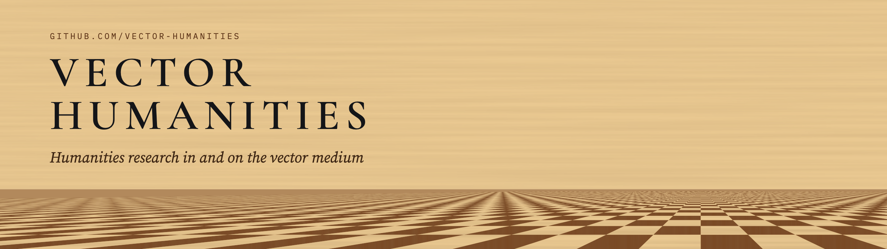

  

  <a href="https://vector-humanities.github.io"><b>Site</b></a> &nbsp;·&nbsp;
  <a href="#projects">Projects</a> &nbsp;·&nbsp;
  <a href="#methods">Methods</a> &nbsp;·&nbsp;
  <a href="https://vector-lab-tools.github.io">Vector Lab</a>

---

**Humanities research in and on the vector medium.**

Large language models and diffusion systems hold text, image and sound as positions in high-dimensional vector spaces, and they generate new material by moving through those spaces. Humanities scholars now meet their archives, their sources and their own research tools inside this **vector medium**.

**Vector Humanities** documents new vector projects drawing on the [Vector Lab](https://vector-lab-tools.github.io) and related tools. Each one has a humanities object at its centre (a book to translate, a corpus to read, an archive to edit) and works on it with methods and theory developed in the wider vector theory programme.

The vector medium is both the instrument and the object of this work. The tools here are built with large language models, and some, such as vector translation, use them on the material directly; the Vector Lab instruments take those same systems as their object of study. A medium used to study itself would be circular if the evidence came from the models' own reports, so the evidence here comes from outside the model: a surviving paper tape, a manuscript leaf, a page image, or a measurement on a model's outputs that can be repeated on the same model.

Vector Humanities also takes a step forward that the vector medium makes possible, here called **vector toolmaking**: creating tools, digital or vector-based, that enable humanities scholars to research and work with their materials. The benches, instruments and toolkits under [Methods](#methods) are its first examples.

## Projects

| Project | Object | Method | Status |
|:--|:--|:--|:--|
| **[Vector Lab](https://vector-lab-tools.github.io)** | The vector medium itself: embedding geometry, token probabilities, diffusion trajectories | Instruments that test interpretive claims against repeatable measurements of model outputs: Manifold Atlas, LLMbench, Vectorscope, Manifoldscope, Theoryscope, Diffusion Atlas, Vectorography | Manifold Atlas and LLMbench live; the others in alpha |
| **偶然性の問題 · The Problem of Contingency** | Kuki Shūzō, *Gūzensei no mondai* (Iwanami, 1935), from the National Diet Library scans of the 1948 printing | Vector translation, read on the [Kuki Research Bench](https://vector-humanities.github.io/kuki-bench/) | Preliminary English translation complete (October 2026), translation and literal version with apparatus; research bench live; to be checked against the *Kuki Shūzō zenshū* and Omodaka's French translation (1966) |
| **[Vector Humanities Editions and Contingencies](https://vector-humanities.github.io/books/)** | Two open series of books: translations made by the vector translation method, and new commissioned work | Vector translation and Vector Book; open access under CC BY 4.0, published with their workings | Series page live; first books in preparation |
| **[Melville Research Bench](https://vector-humanities.github.io/melville/)** (Michael Jonik and David M. Berry) | Herman Melville, *Billy Budd* in four versions (manuscript before revision, last readings, diplomatic, MEL reading text) and the short tales, from the Melville Electronic Library's TEI | Research bench on [bench-kit](https://github.com/critical-code-studies/bench-kit) | Alpha |
| **[ELIZA (1964–68)](https://findingeliza.org)** (David M. Berry, Sarah Ciston, Anthony C. Hay, Mark C. Marino, Peter Millican, Arthur I. Schwarz, Jeff Shrager and Peggy Weil) | Weizenbaum's ELIZA and DOCTOR (MIT, 1964–68), with its scripts, conversations and ports | Critical code studies: research bench, collation, Implementations and paratext archives | Active: site and bench live |
| **[Spacewar! (1962)](https://spacewar1962.github.io/spacewar/)** (David M. Berry and Mark C. Marino, with Anthony Hay, Sarah Ciston, Art Schwarz, Claire Carroll and Norbert Landsteiner) | The DEC PDP-1 space-combat game written at MIT in 1961–62, its Macro assembly source and surviving versions | Critical code studies reading, with a runnable PDP-1 emulator and the Research Bench | Site and Research Bench live; monograph in progress |
| **[SHRDLU (1968–70)](https://critical-code-studies.github.io/SHRDLU/)** (David M. Berry and Mark C. Marino) | Terry Winograd's natural-language-understanding program, MacLisp and Micro-Planner, MIT AI Lab | Critical code studies reading, with the SHRDLU Research Bench on bench-kit | Site and Research Bench live |
| **[Nostos](https://nostos-ai.vercel.app)** (David M. Berry, 2026) | A vibe-coded game and web-world in the vector medium | Vibe coding; critical code studies as play; an in-world Standard ML checked against a formal definition | Playable beta, in development |

Further projects will be listed here as they begin. Projects led elsewhere that follow the conventions below are welcome; to propose one, open an issue on the [site's GitHub repository](https://github.com/vector-humanities/vector-humanities.github.io/issues).

## Methods

| Method | Developed in | Used here for |
|:--|:--|:--|
| **Vector theory** | Berry, D. M. (2026) '[Vector theory: epistemology, political economy, and probabilistic computation](https://doi.org/10.1007/s13347-026-01162-w)', *Philosophy & Technology*, 39, 149 | The account of the medium: difference becomes distance, meaning becomes location, and the geometry shapes what can be represented, retrieved and said |
| **Vector Lab instruments** | [vector-lab-tools](https://github.com/vector-lab-tools): Manifold Atlas, LLMbench, Vectorscope, Manifoldscope, Theoryscope, Diffusion Atlas, Vectorography | Testing interpretive claims against the measured behaviour of embedding and language models |
| **Critical code studies** | [critical-code-studies](https://github.com/critical-code-studies) | Close reading of the code, prompts and briefs that do the work in a project |
| **Computational Hermeneutics** | [Computational-Hermeneutics](https://computational-hermeneutics.github.io/): CCSbench (based on CCS-WB classic), Source Variorum, Glas Bench; hermes-kit in preparation | Close reading and comparison of code and text as cultural artefacts, with the apparatus of textual criticism |
| **Bench Kit** | [bench-kit](https://critical-code-studies.github.io/bench-kit/) | Shared modules for research benches: versions and their genealogy, comparison, annotation shared through Hypothesis, paratexts, findings and export. The SHRDLU, Spacewar!, ELIZA, Melville and Kuki benches are built on it |
| **Vector translation** | [vector-translation](https://vector-humanities.github.io/vector-translation/) (v0.1.1) | A method and toolkit for translating books from page images with AI agents under a translator's direction: procedure, rules, Claude Code skills, brief templates and checking scripts |
| **Vector Book** | [vector-book](https://github.com/vector-humanities/vector-book) (alpha) | Book design and typesetting for editions and translations: Markdown through Pandoc and Typst to a print-ready PDF, with source page numbers, translator's notes and glossed figures |

## Working conventions

- **Provenance.** Every project records its source edition, the scans it works from, and their rights status.
- **AI disclosure.** Machine drafting is identified as such. Decisions on terms, readings and corrections are logged in the project with their dates.
- **Instrument and material.** Where a model is used to read or measure, the project tries to separate what belongs to the instrument from what belongs to the material.
- **Open Access.** Public-domain sources and project outputs can be published through this work. Open access publications are a key output of this project wherever possible. This project is committed to open science practices.

## Related

- **[Vector Lab](https://vector-lab-tools.github.io)**: research instruments for reading the vector medium.
- **[Critical Code Studies](https://critical-code-studies.github.io)**: tools and benches for reading code as cultural text.

---

Vector Humanities is a research lab directed by <a href="https://github.com/dmberry">David M. Berry</a> (University of Sussex).

The mark is the rhombicuboctahedron Leonardo drew for Luca Pacioli's <i>De divina proportione</i> (1509), as a wireframe. The banner is an intarsia pavement in perspective, after the inlaid-wood panels of Fra Giovanni da Verona.
